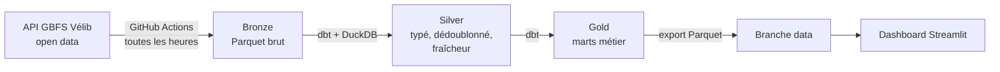

# Vélib Pipeline

[](https://github.com/LouedLE/velib-pipeline/actions/workflows/ci.yml)
[](https://github.com/LouedLE/velib-pipeline/actions/workflows/collect.yml)

Pipeline de données de bout en bout sur le réseau Vélib Métropole, toutes stations confondues.
Il collecte l'état du réseau toutes les heures, le transforme avec dbt et DuckDB, et publie un dashboard.

**Question traitée :** quelles stations sont inutilisables (vides ou pleines), à quelle heure, et combien de temps ?

**Dashboard :** _lien Streamlit à ajouter après déploiement_

## Architecture



| Couche | Contenu | Modèles |
|---|---|---|
| Bronze | Un fichier Parquet par collecte, champs de la source conservés | `sources.yml` |
| Silver | Types, fuseau horaire Paris, dédoublonnage, détection des données périmées | `stg_station_status`, `stg_station_information`, `int_valid_status` |
| Gold | Indicateurs prêts pour l'analyse | `dim_station`, `mart_station_reliability`, `mart_hourly_profile`, `mart_network_timeseries` |

## Qualité des données

27 tests dbt tournent à chaque collecte. Si un test bloquant échoue, rien n'est publié.

- Unicité et non-nullité des clés.
- Bornes de valeurs : vélos et capacité entre 0 et 1 000 (des stations événementielles dépassent 400 places), coordonnées dans la zone Île-de-France, pourcentages entre 0 et 1.
- Cohérence : vélos mécaniques + électriques = total disponible.
- Intégrité référentielle entre les marts et le référentiel des stations.
- Avertissement (non bloquant) quand vélos + bornes libres dépassent la capacité déclarée. La source le fait parfois : le test le signale sans arrêter la chaîne.

Une station dont la dernière remontée date de plus de 60 minutes est marquée périmée et exclue des indicateurs. Sans ce filtre, une station en panne figée à 0 vélo gonflerait le taux de stations vides.

## Choix techniques

- **DuckDB plutôt qu'un entrepôt cloud** : le volume tient sur une machine (une ligne par station et par heure, quelques dizaines de milliers de lignes par jour), zéro coût, zéro serveur.
- **Parquet partitionné par date** : lecture rapide par DuckDB, fichiers compacts.
- **Branche `data` réécrite à chaque collecte** : un seul commit écrasé, l'historique Git ne grossit pas.
- **Identifiants de station en texte** : certains dépassent 2^31 et seraient tronqués en entier 32 bits.
- **Heure de Paris calculée dans dbt** : les profils horaires suivent l'heure locale, changement d'heure compris.

## Lancer le projet

Prérequis : Python 3.11+ et [uv](https://docs.astral.sh/uv/).

```bash
make install     # dépendances
make demo        # 7 jours de données simulées, pour tester sans attendre
make build       # dbt build : transformations + tests
make export      # tables gold en Parquet
make dashboard   # http://localhost:8501
```

Pour collecter un instantané réel au lieu des données simulées : `make collect`.

## Structure

```
src/velib_pipeline/   collecte (ingest.py), données simulées (demo.py), export gold
dbt/models/           bronze (sources), silver, gold
dbt/tests/            tests personnalisés
dashboard/app.py      application Streamlit
tests/                tests Python (pytest)
.github/workflows/    CI et collecte horaire
```

## Limites connues

- GitHub désactive les workflows planifiés après 60 jours sans activité sur le dépôt.
- Les horaires GitHub Actions ne sont pas garantis à la minute : certaines collectes arrivent en retard ou sautent.
- Une collecte par heure ne capte pas les rotations rapides en heure de pointe.

## Source

Données : flux GBFS open data de Vélib Métropole, `https://velib-metropole-opendata.smovengo.cloud/opendata/Velib_Metropole/`.
